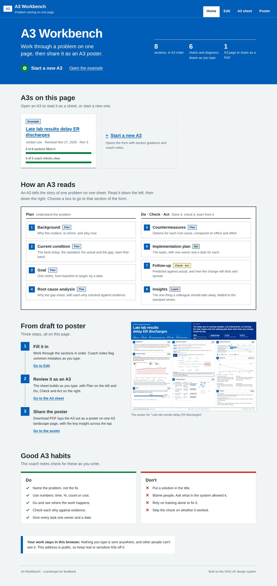
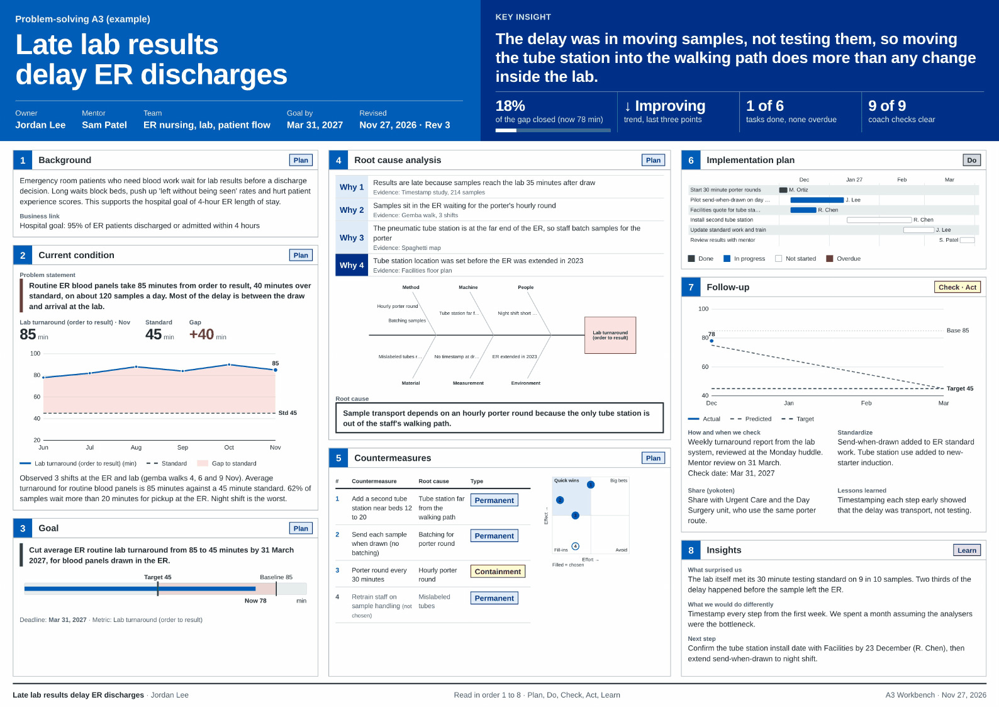
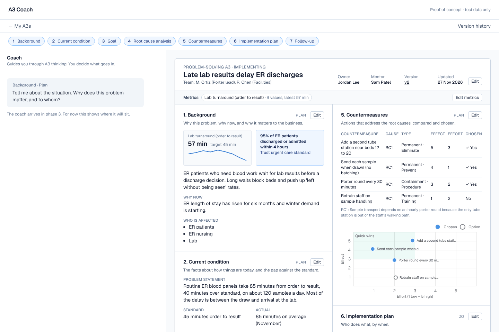
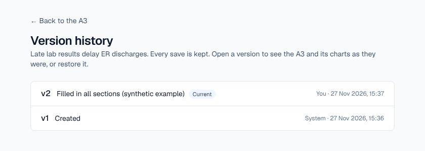
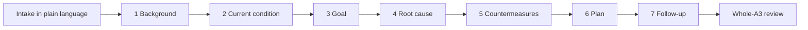

# A3 dashboard

Use the **[public A3 Workbench](https://stephjm24.github.io/a3-dashboard/)** to try a problem-solving A3 with synthetic data, or [run the full app locally](#run-locally) to work through an invite-only, versioned A3.

| | GitHub Pages Workbench | Full Next.js app |
| --- | --- | --- |
| Access and saving | Opens on Home without sign-in. Edits are saved in the current browser. | Sign in with a one-time invite. Each user’s A3s and saved versions live in PostgreSQL. |
| Editing and review | Edit the seven sections and an eighth Insights section. Switch between Edit, A3 sheet and Poster views. | Edit all seven sections, import metric values from CSV or Excel, then open or restore an earlier version with its charts. |
| Coaching and export | Rule-based coach notes and a downloadable one-page landscape poster PDF. | The coach pane shows its opening prompt. Interactive coaching and PDF export are planned for phases 3 and 4 respectively. |
| Source | [Workbench files and usage](prototype/a3-workbench) | [Application source](src) and [delivery plan](docs/delivery.md) |

Use synthetic test data for local development, the public example and tester sessions.

## GitHub Pages Workbench

The [prototype](prototype/a3-workbench) is a single page for quick feedback from colleagues, styled on the NHS.UK design system. You fill in a form on the left and the A3 builds on the right. Coach notes flag common mistakes, and section 8, Insights, adds the key takeaway to the standard seven. **Download PDF** saves a poster that fills one A3 landscape page. A home page opens first. The prototype is separate from the app and shares no code with it.


<details>
<summary>The home page, the finished A3 and the poster PDF in the prototype</summary>






</details>

## Full application

The app screenshots below use the synthetic example “Late lab results delay ER discharges”.

### The A3 workspace

The coach sits on the left. The A3 sits on the right, with the Plan sections in the left column and Do, Check and Act in the right. The strip across the top jumps to each section. The coach pane shows its opening prompt, and the full coach arrives in phase 3.



<details>
<summary>The whole A3, with every section and chart</summary>

Each chart is drawn from the saved version of the A3:

- **Background:** a KPI tile
- **Current condition:** a run chart with the gap shaded, and a breakdown with Pareto
- **Goal:** a bullet chart
- **Root cause analysis:** a 5 Whys chain and a fishbone
- **Countermeasures:** an effect against effort matrix
- **Implementation plan:** a Gantt chart
- **Follow-up:** predicted against actual results


</details>

### Editing a section

Each section opens in its own editor. A save becomes the next version, and the button says which version that will be.


### Version history

Every save is kept. Any version can be opened read-only or restored.



## How it will work

The design below is the agreed target. Phases 1 and 2 are built: sign-in, the A3 workspace, editing, versions and charts. The guided coach, the review checks and PDF export from the app come in the later phases listed in the [delivery plan](docs/delivery.md).

A person describes the problem in their own words. The coach works through the sections in A3 order and proposes text and numbers as drafts in the A3 boxes. Nothing becomes part of the A3 until the person accepts or edits it.


The coach follows the A3 sections in order. Each section has core questions, follow-up questions where answers are thin, and challenge questions when it spots a common mistake. At the end it reviews the whole A3 by reading it in reverse.



The [system architecture](docs/architecture.md) has the full diagrams: system context, a single coach turn, environments and stored data.

## Run locally

Use Node.js 22.18 or later, npm and PostgreSQL. With Docker Compose installed, run the following from the repository root. In PowerShell, use `Copy-Item .env.example .env` for the first command. Create the local environment file on first setup only.

```sh
cp -n .env.example .env
docker compose up -d --wait db
npm ci
npm run db:deploy
npm run invite -- tester@example.com
npm run dev
```

Open the invite URL printed by the command and enter your name. It is single-use and expires after 14 days. After signing in, open **My A3s**, enter a problem title and open the new A3. On subsequent starts, bring up the database and run `npm run dev`.

## Find your way around

| To work on | Start here |
| --- | --- |
| Pages, navigation and server actions | [src/app](src/app) |
| The A3 sheet, coach pane and progress strip | [src/components/a3](src/components/a3), with section editors in [editors](src/components/a3/editors) and charts in [charts](src/components/a3/charts). Shared forms and sign-out live in [src/components](src/components). |
| A3 sections, validation, editing, versions, imports, chart options and database access | [src/lib/a3](src/lib/a3). TypeScript unit tests sit beside the code they cover. |
| Sign-in, sessions and invites | [src/lib/auth](src/lib/auth) and the [invite creation script](scripts/create-invite.ts) |
| Database tables and migration history | [prisma/schema.prisma](prisma/schema.prisma) and [prisma/migrations](prisma/migrations) |
| Versioned reference data and synthetic samples | [Data guide](docs/data.md), [contracts](data/schemas) and [fixtures](tests/fixtures) |
| A no-install prototype for colleague feedback | [prototype/a3-workbench](prototype/a3-workbench), a single page that is separate from the app |
| Running checks and submitting a change | [Contributor guide](CONTRIBUTING.md) and [CI workflows](.github/workflows) |

## Project guides

- [System architecture](docs/architecture.md) shows how the proposed coach, A3 workspace and storage fit together. [Decision records](docs/decisions) preserve the reasoning behind those choices.
- [Delivery plan](docs/delivery.md) lists the six phases, what the product owner reviews and where deployments are planned.
- [Changelog](CHANGELOG.md) records additions awaiting release.
- [Compliance audit](docs/compliance/COMPLIANCE_AUDIT.md) and [action plan](docs/compliance/COMPLIANCE_ACTION_PLAN.md) record the privacy, security, accessibility and licensing checks, with draft [privacy notice](docs/legal/PRIVACY_POLICY.md) and [tester terms](docs/legal/TERMS_OF_USE.md) awaiting approval. Report vulnerabilities as described in [SECURITY.md](SECURITY.md).
