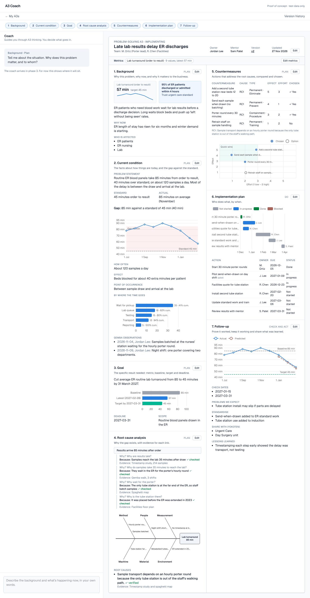
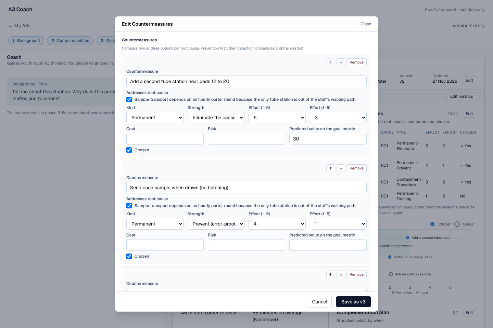
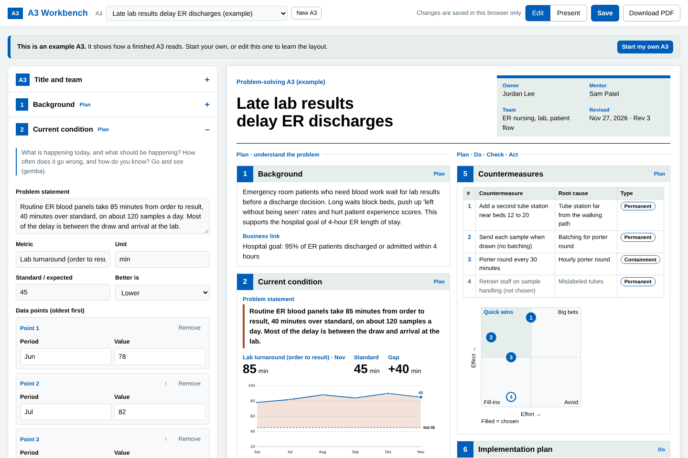
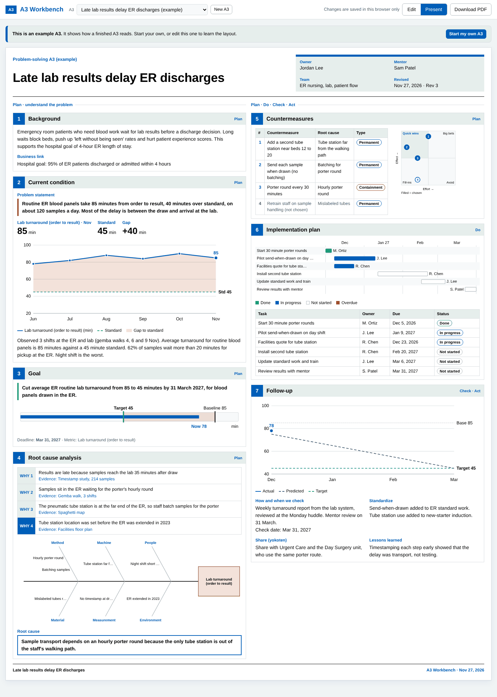
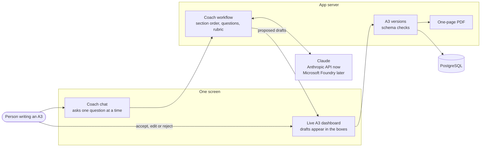
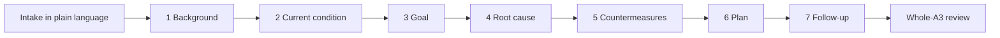

# A3 dashboard

An invite-only workspace for developing a seven-section problem-solving A3. In the current version, a tester can sign in, create an A3 and fill in every section by hand. Each save becomes a new version that can be reopened or restored from **Version history**, and the charts redraw from the version on screen. Metric values can be typed or imported from CSV or Excel. The coach pane shows the opening prompt; interactive coaching follows in phase 3. Use synthetic test data for local development and tester sessions.

To try the A3 layout without installing anything, open the [A3 Workbench prototype](https://stephjm24.github.io/a3-dashboard/) ([source](prototype/a3-workbench)).

## What it looks like

These screenshots show the app as it runs today, filled in with the synthetic example "Late lab results delay ER discharges". None of the people, numbers or dates are real.

### The A3 workspace

The coach sits on the left. The A3 sits on the right, with the Plan sections in the left column and Do, Check and Act in the right. The strip across the top jumps to each section. The coach pane shows its opening prompt, and the full coach arrives in phase 3.


<details>
<summary>The whole A3, with every section and chart</summary>

Each chart is drawn from the saved version of the A3:

- **Background:** a KPI tile
- **Current condition:** a run chart with the gap shaded, and a breakdown with Pareto
- **Goal:** a bullet chart
- **Root cause analysis:** a 5 Whys chain and a fishbone
- **Countermeasures:** an effect against effort matrix
- **Implementation plan:** a Gantt chart
- **Follow-up:** predicted against actual results



</details>

### Editing a section

Each section opens in its own editor. A save becomes the next version, and the button says which version that will be.



### Version history

Every save is kept. Any version can be opened read-only or restored.


### A3 Workbench prototype

The [prototype](prototype/a3-workbench) is a single page for quick feedback from colleagues, in NHS styling. You fill in a form on the left and the one-page A3 builds on the right. Coach notes flag common mistakes, and **Download PDF** saves the A3 as one landscape A3 page. It is separate from the app and shares no code with it.



<details>
<summary>The finished one-page A3 in the prototype</summary>



</details>

## How it will work

The design below is the agreed target. Phases 1 and 2 are built: sign-in, the A3 workspace, editing, versions and charts. The guided coach, the review checks and PDF export from the app come in the later phases listed in the [delivery plan](docs/delivery.md).

A person describes the problem in their own words. The coach works through the sections in A3 order and proposes text and numbers as drafts in the A3 boxes. Nothing becomes part of the A3 until the person accepts or edits it.



The coach follows the A3 sections in order. Each section has core questions, follow-up questions where answers are thin, and challenge questions when it spots a common mistake. At the end it reviews the whole A3 by reading it in reverse.



The [system architecture](docs/architecture.md) has the full diagrams: system context, a single coach turn, environments and stored data.

## Run locally

Use Node.js 22.18 or later, npm and PostgreSQL. With Docker Compose installed, run the following from the repository root. In PowerShell, use `Copy-Item .env.example .env` for the first command. Create the local environment file on first setup only.

```sh
cp -n .env.example .env
docker compose up -d --wait db
npm ci
npm run db:deploy
npm run invite -- tester@example.com
npm run dev
```

Open the invite URL printed by the command and enter your name. It is single-use and expires after 14 days. After signing in, open **My A3s**, enter a problem title and open the new A3. On subsequent starts, bring up the database and run `npm run dev`.

## Find your way around

| To work on | Start here |
| --- | --- |
| Pages, navigation and server actions | [src/app](src/app) |
| The A3 sheet, coach pane and progress strip | [src/components/a3](src/components/a3), with section editors in [editors](src/components/a3/editors) and charts in [charts](src/components/a3/charts). Shared forms and sign-out live in [src/components](src/components). |
| A3 sections, validation, editing, versions, imports, chart options and database access | [src/lib/a3](src/lib/a3). TypeScript unit tests sit beside the code they cover. |
| Sign-in, sessions and invites | [src/lib/auth](src/lib/auth) and the [invite creation script](scripts/create-invite.ts) |
| Database tables and migration history | [prisma/schema.prisma](prisma/schema.prisma) and [prisma/migrations](prisma/migrations) |
| Versioned reference data and synthetic samples | [Data guide](docs/data.md), [contracts](data/schemas) and [fixtures](tests/fixtures) |
| A no-install prototype for colleague feedback | [prototype/a3-workbench](prototype/a3-workbench), a single page that is separate from the app |
| Running checks and submitting a change | [Contributor guide](CONTRIBUTING.md) and [CI workflows](.github/workflows) |

## Project guides

- [System architecture](docs/architecture.md) shows how the proposed coach, A3 workspace and storage fit together. [Decision records](docs/decisions) preserve the reasoning behind those choices.
- [Delivery plan](docs/delivery.md) lists the six phases, what the product owner reviews and where deployments are planned.
- [Changelog](CHANGELOG.md) records additions awaiting release.
