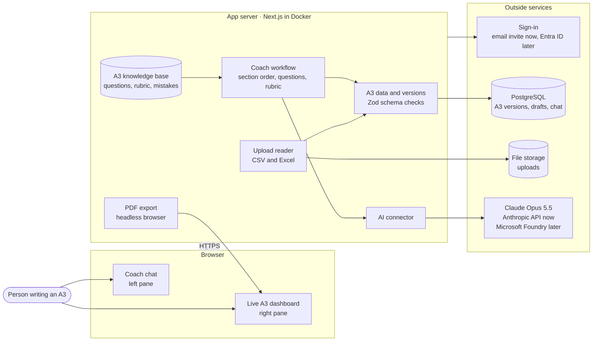
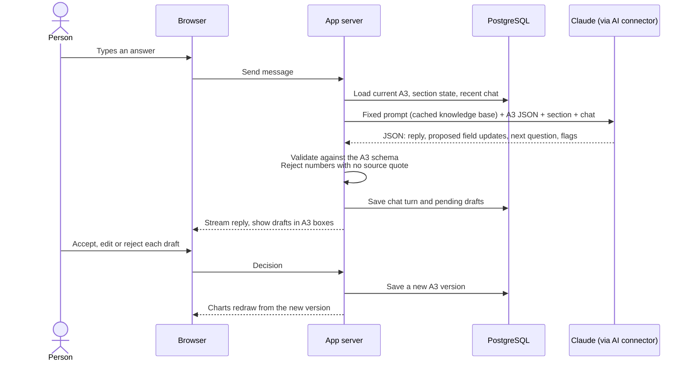
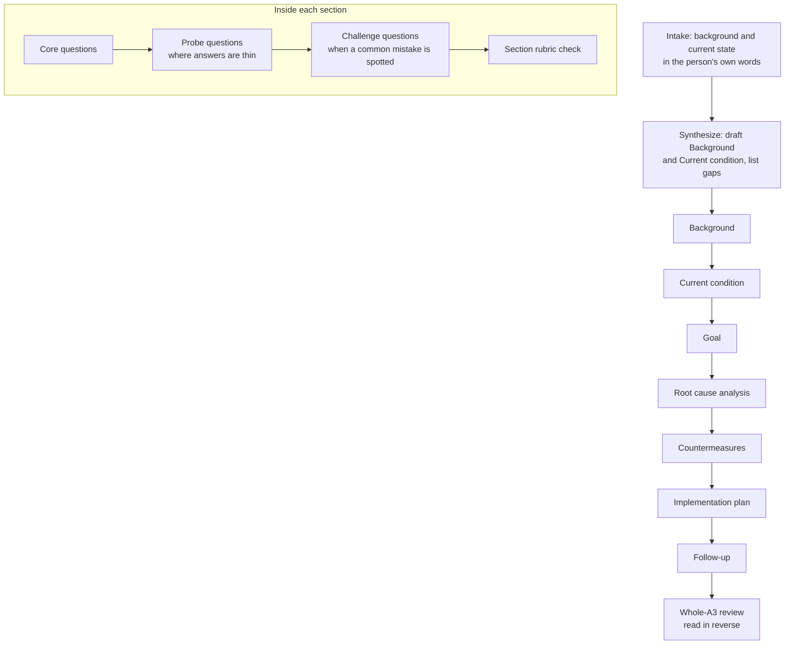
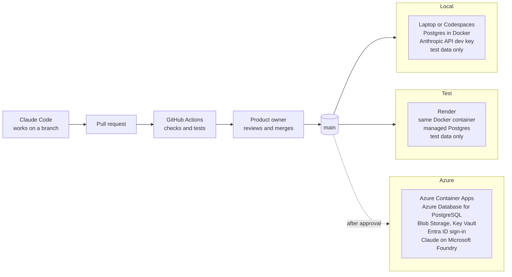
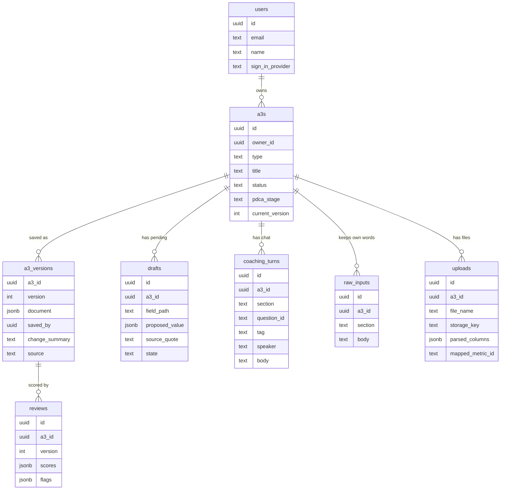

# System architecture

Version 0.1, agreed with the product owner on 27 November 2026. The full design, with the reasoning behind each choice, is in [A3 Coach App: System Architecture v0.1](https://claude.ai/artifact/XSZj8WzCkwsijUGeY7SbPL). The decisions are recorded in [0002 · System architecture for the proof of concept](decisions/0002-system-architecture.md).

A person describes a problem in plain language. A guided AI coach turns it into a problem-solving A3 on a live dashboard. The coach proposes text and numbers, and the person accepts or edits every one before it becomes part of the A3.

The diagrams describe the agreed target. The [README](../README.md) lists what runs today and the [delivery plan](delivery.md) assigns each remaining capability to a phase.

## 1. System context

The browser talks only to the app server. The server is the only part that talks to the database, file storage, sign-in and Claude. Moving to Azure changes the services on the right, not the app.

## 2. One coach turn

Each chat message runs one guided step. The app's code picks the section and the question; Claude only writes within that step and must answer in a fixed JSON shape. Nothing reaches the A3 until the person accepts it.

## 3. Coaching flow across the A3

The coach moves through the sections in A3 order. Each section has a soft gate: it is marked done once its core questions are answered, but the person can move on or go back at any time.

## 4. Environments and delivery

GitHub runs application and foundation checks on pull requests and pushes to `main`. The diagram shows the intended deployment flow for the tester and Azure phases. Local and tester environments use test data.

## 5. Stored data

Each A3 is stored as a whole JSON document per version, following the A3 data model. The tables around it hold users, drafts, chat, uploads and reviews.

## Target technology stack

| Layer | Choice |
| --- | --- |
| App framework | Next.js with TypeScript |
| Look and components | Tailwind CSS with shadcn/ui |
| Database access | Prisma with PostgreSQL |
| Validation | Zod, one schema for the A3 data model |
| Sign-in | One-time invite links with server-side sessions now; Microsoft Entra ID added in phase 6 |
| AI | Anthropic TypeScript SDK, with its Foundry client later |
| Charts | Apache ECharts, plus custom SVG for fishbone and 5 Whys |
| Spreadsheets | ExcelJS on the server, see [0003](decisions/0003-manual-editing-and-imports.md) |
| PDF | Playwright printing the A3 page |
| Tests | Vitest, Playwright, and a set of sample problems for the coach |
