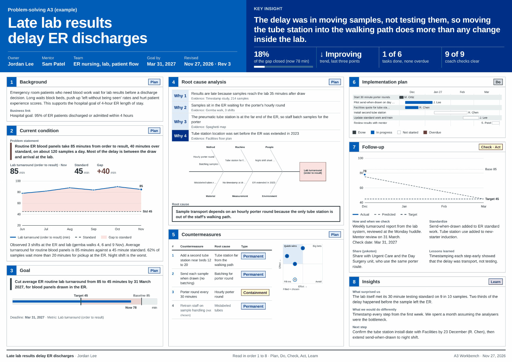

# A3 Workbench prototype

A single-page version of the A3 dashboard that needs no install, database or sign-in. It is for gathering early feedback from colleagues while the full app in [src](../../src) is built. It does not replace the app and shares no code with it.

You fill in the header and the problem-solving sections in a form. The page lays them out as a one-page A3 styled on the [NHS.UK design system](https://service-manual.nhs.uk/design-system), without NHS logos. It has these charts:

- a run chart with the gap to standard shaded
- a goal bullet chart
- a 5 Whys chain and a fishbone
- an effect against effort matrix
- a Gantt chart
- a chart of predicted against actual results

Coach notes under each section flag the common mistakes listed in the A3 knowledge base.

Section 8, **Insights**, comes after Follow-up and adds to the standard seven boxes. You write the key insight, what surprised you, what you would do differently and the next step. The page works out how much of the gap is closed, the recent trend, tasks done and overdue, and how many coach checks are clear.

The page has four views:

- **Home** opens first. It lists the A3s on the page with how complete each one is. It also shows how an A3 reads, the three steps from draft to poster with a preview of the poster, good A3 habits, and where your work is saved.
- **Edit** shows the form beside the live A3.
- **A3 sheet** shows the A3 as a ruled sheet, Plan on the left and Do, Check and Act on the right.
- **Poster** shows the page that **Download PDF** produces. It fills one A3 landscape page edge to edge, like a research poster. The title and key insight run across the top, and the eight sections follow in reading order in three columns. The page picks the column split and the largest text and chart size that fit.



## Three ways to use it

| | Hosted copy on claude.ai | GitHub Pages | Opened from this folder |
| --- | --- | --- | --- |
| Address | Shared by the owner | https://stephjm24.github.io/a3-dashboard/ | http://localhost:8000 |
| Who can open it | People the owner shares it with | Anyone with the address | Anyone with the files |
| Where edits are saved | On the hosted page, for everyone who opens it | In that person's browser only | In that person's browser only |
| Comments | Comment button on each section | Not available | Not available |
| PDF | Download PDF | Download PDF | Download PDF |

Share the hosted copy for live feedback on one A3. Send the GitHub Pages address when colleagues should try the tool with their own A3. Nothing they type leaves their browser. Because the Pages address is public, keep real or sensitive A3s out of `a3.json`. Their work stays in that browser's storage until they clear it, so on a shared computer the next person can see it. Any other GitHub Pages site under `stephjm24.github.io` can also read that storage, so publish only trusted sites there.

The [Prototype Pages workflow](../../.github/workflows/prototype-pages.yml) publishes `index.html` and `a3.json` from this folder when a change to them reaches `main`. Nothing else in the repository is published. [scripts/pages_site.py](../../scripts/pages_site.py) adds a Content Security Policy to the published page, since GitHub Pages cannot send security headers. The policy lets only the page's own script run, so a script typed into a field cannot. Every value typed into the form is also escaped before it is shown. It can also be run by hand from the Actions tab. Before the first run, a maintainer sets **Settings > Pages > Build and deployment > Source** to **GitHub Actions**.

To try it locally:

```sh
cd prototype/a3-workbench
python3 -m http.server 8000
```

Then open http://localhost:8000. The page loads `a3.json` from the same folder, so opening `index.html` straight from disk shows a blank A3 instead of the example.

## Files

- [index.html](index.html) is the whole prototype: styles, form, A3 layout and charts. The PDF export loads html2canvas 1.4.1 and jsPDF 4.2.1 from cdn.jsdelivr.net when first used. Each is pinned with a Subresource Integrity hash, so the browser refuses a changed file. When you change either version, update its URL and hash together in `PDF_LIBS`.
- [a3.json](a3.json) holds the starting A3s. It contains one synthetic example, "Late lab results delay ER discharges". Keep real or sensitive A3s out of this file.

## Keeping the two copies in step

The hosted copy is published from the body of `index.html`, which is everything between `<body>` and `</body>`. When you change the prototype, change it here first, then republish the hosted copy from the same content. Edits made on the hosted page live only there and are not copied back into this repository.
